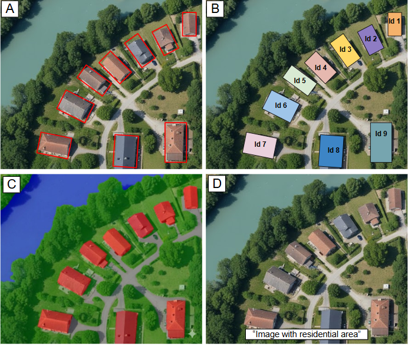
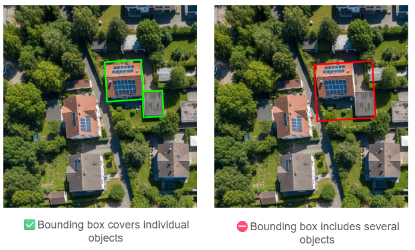
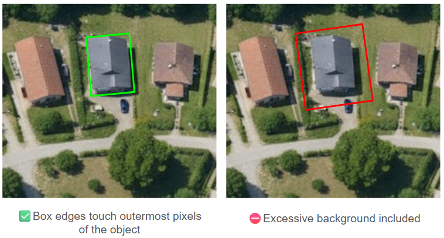
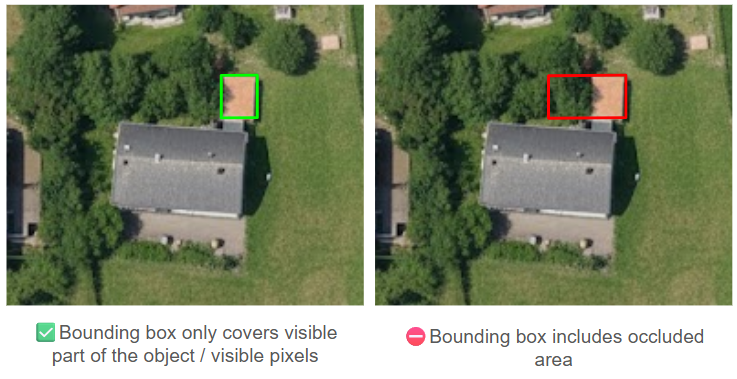
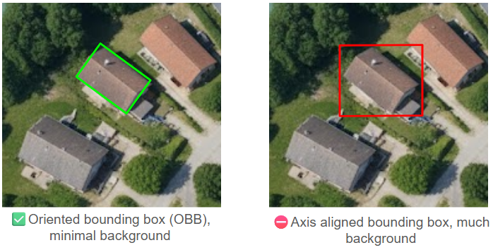
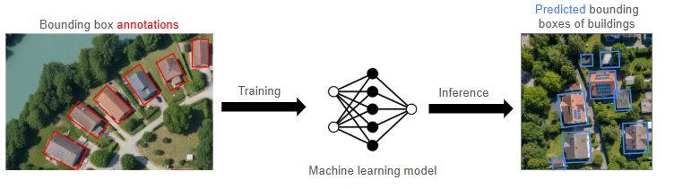

# Aerial & Satellite Image Annotation

## Best Practices & Visual Guide for Object Detection

**Author:** Fabian Löw · **Version:** v0.4 · **Status:** living document

> **Note:** This is an evolving document. Some sections still require rigorous validation, including from scientific publications. Use with caution. Missing chapters (t.b.d.): 6.4.1 Scale Imbalance Considerations, 6.4.2 Class Imbalance Considerations. Key sources are listed under [References](#references--further-reading).

**Contents**

1. [Overview Computer Vision Tasks](#1-overview-computer-vision-tasks)
2. [Scope of this guideline](#2-scope-of-this-guideline)
3. [Annotations in Object Detection](#3-annotations-in-object-detection)
4. [What are bounding boxes?](#4-what-are-bounding-boxes)
5. [Preparation](#5-preparation)
6. [Best Practices for Accurate Bounding Box Annotation](#6-best-practices-for-accurate-bounding-box-annotation)
7. [Example: Annotating Buildings & Urban Area](#7-example-annotating-buildings--urban-area)
8. [Additional Considerations & Advanced Topics](#8-additional-considerations--advanced-topics)
9. [Validation and Review](#9-validation-and-review)
10. [Appendix](#appendix)
11. [References & further reading](#references--further-reading)

---

## 1. Overview Computer Vision Tasks

**Computer Vision (CV)** is a subfield of **Artificial Intelligence (AI)**, and **Machine Learning (ML)** is a dominant methodology/technique used to solve CV problems. Common CV **tasks** include (compare Figure 1):

1. **Object Detection** – Locates multiple objects with bounding boxes and classifies each one into thematic categories (e.g., "Building").
2. **Instance Segmentation** – Labels every pixel and distinguishes between individual object instances (e.g., Building#1, Building#2, Building#3).
3. **Semantic Segmentation** – Labels every pixel with a class, but treats all instances of the same class as one (e.g., all objects are just "Buildings").
4. **Image Classification** – Assigns a single label to the entire image (e.g., "This is a residential area").

*Figure 1: Examples of common tasks in computer vision: (A) Object Detection, (B) Instance Segmentation, (C) Semantic Segmentation, and (D) Image Classification.*

## 2. Scope of this guideline

This guide provides **basic best practices** for **annotating** aerial and satellite imagery for training CV models for **object detection**.

## 3. Annotations in Object Detection

There are basically two primary annotation approaches in object detection, using **bounding boxes** and **instance / semantic segmentation**. Using bounding boxes is the most widely adopted and efficient annotation method. It is based on rectangles to define the location and category of objects within an image.

*Advantages:*

- Fast and straightforward to implement
- Ideal for well-defined, discrete objects such as vehicles, individual trees, or standalone structures

*Common Applications:*

- Vehicle counting in parking facilities
- Detection of isolated buildings
- Rapid object identification in high-resolution satellite imagery

Semantic / instance segmentation on the other hand use polygons or pixel-masks to delineate the objects of interest. This approach delivers pixel-level precision by tracing the exact contours of objects through polygons or masks. It offers significantly more detail than bounding box annotation.

*Advantages:*

- Captures precise object geometry and boundaries
- Essential for objects with irregular or complex shapes, including dense vegetation, non-standard building forms, and meandering pathways

*Common Applications:*

- Detailed delineation of agricultural parcels and forested areas
- Precise building footprint extraction in urban settings
- Accurate mapping of roads and waterways from drone or aerial imagery

**Annotation** is the process of marking and classifying items (objects) in images. This is important because ML models require large sets of **annotated training data** (see Figure 2). Image annotation involves **identifying and labeling specific objects** such as buildings, roads, trees, or even bodies of water, in images.

*Figure 2: Training a machine learning (ML) model using ground truth bounding box annotations (left) to enable accurate object localization during inference (right).*

Object detection relies on so-called **bounding box annotations**. Bounding boxes are used to **identify, localize and classify** objects within images. They serve as the foundation for training object detection algorithms in CV. They define the object's **position, size**, and the **type or category** (such as "building" or "tree"), creating **labeled training data** that a ML algorithm can use to detect and classify similar objects automatically in new images. Accurate and contextualized annotations are essential for object detection (YOLO, Faster R-CNN) algorithms.

Data annotation **techniques** are varied and depend on the type of data and the **task** (see [Overview Computer Vision Tasks](#1-overview-computer-vision-tasks)):

- **A: Object detection** (described in this guideline): Involves identifying specific objects within an image and defining their precise location using bounding boxes and class labels. It requires coordinates of bounding boxes and class labels.
- **B: Instance Segmentation**: Involves detecting and outlining each distinct object at the pixel level, distinguishing between individual instances of the same category (e.g., distinguishing between two or more different buildings). It requires pixel-level mask annotations for each distinct object instance; some architectures (like Mask R-CNN) also use bounding boxes derived from these masks.
- **C: Semantic segmentation**: Involves classifying every single pixel in an image into a predefined category, treating multiple objects of the same class as a single entity without distinguishing between them. Semantic segmentation requires pixel-level mask annotations.
- **D: Image classification**: Involves assigning a label or category to a complete image based on its content ("residential area" or "forest landscape", or "body of water").

## 4. What are bounding boxes?

Image **bounding box annotation** involves manually or (semi)automatically drawing **rectangles** around objects in an image. Each box is assigned a **class label**, telling the object detection algorithm what it represents.

Generally, bounding boxes are **axis aligned** and **rectangular**. In specific domains where rotation matters, such as aerial/satellite imagery (buildings, vehicles at various angles), **oriented bounding boxes (OBB)** are used. Note, if rectangular boxes (even rotated ones) don't capture object boundaries well enough, the standard approach is **instance segmentation**, which provides pixel-level masks, rather than object detection.

A **bounding box annotation** defines the spatial extent and categorical identity of an object within an image. All object detection models require two fundamental pieces of information from their annotations:

- **Spatial Extent (Geometry):** Defines the object's location and size using coordinates. The two primary representations used for this are:
  - **Center-based coordinates:** The box is defined by its center point and dimensions (x_c, y_c, width, height).
  - **Corner coordinates:** The box is defined by its top-left and bottom-right points (x1, y1, x2, y2).
- **Categorical identity:** Defines the object's type, typically represented by a unique **Class ID** (e.g., 0 for "Building", 1 for "Car") or a corresponding class name.

Note that the format might be different, depending on the object detection algorithm used (see Tables 1 and 2).

*Table 1: Typical file storage formats (on disk) of bounding box annotations. These formats are internationally recognized and widely supported by the most common Machine Learning frameworks.*

| Format Standard | Format | Coordinate Space | Where is the Class ID? | OBB Support (Oriented) | Notes / Usage |
| --- | --- | --- | --- | --- | --- |
| **YOLO** (.txt) | **Center-based** `[class_id, x_c, y_c, w, h]` (w=width, h=height) | **Normalized** [0, 1] | **First number in row** (Index 0) `[0, 0.5, 0.5, ...]` | **Corner Points** `[class_id x1 y1 x2 y2 x3 y3 x4 y4]` (Normalized) | Used by Ultralytics (YOLOv5/v8/11). One .txt file per image. The center (x_c, y_c) is used. In code, tensors are often converted to pixels, but inputs must be normalized. |
| **COCO** (.json) | **Top-Left, Width** `[x_top_left, y_top_left, width, height]` | **Pixel** (Absolute) | **JSON Key** `"category_id": 1` | **Not Native** (Requires custom JSON fields) | The industry standard for dataset exchange. Supported by almost all frameworks via data loaders. Origin is top-left. Extensions like DOTA or custom `segmentation` fields with 8 points are common workarounds for OBB. |
| **Pascal VOC** (.xml) | **Corners** `[x_top_left, y_top_left, x_bottom_right, y_bottom_right]` | **Pixel** (Absolute) | **XML Tag** `<name>cat</name>` | **Not Supported** | Older standard. Coordinates are sometimes 1-indexed (MATLAB style), usually parsed as 0-indexed in Python. |

*Table 2: Runtime tensors (what the code expects when loading annotations into tensors).*

| Framework / Library | Tensor Shape (Geometry) | Coordinate Space | Class ID? | OBB Tensor Shape | Critical Notes |
| --- | --- | --- | --- | --- | --- |
| **PyTorch** (Faster/Mask R-CNN) | **Corners** `[x1, y1, x2, y2]` FloatTensor | **Pixel** (Absolute) | **Separate Tensor** `target['labels']` Int64Tensor | **Not Standard** (Needs library like JDet) | Strictly expects top-left/bottom-right corners. Mixing up xywh here leads to massive loss errors. |
| **TensorFlow** (Obj Det API) | **Corners (Inverted)** `[y_min, x_min, y_max, x_max]` | **Normalized** [0, 1] | **Separate Tensor** `detection_classes` Float (cast to Int) | **Not Standard** | Uses y, x ordering! This is the most common cause of TF bugs. |
| **MMRotate** (OpenMMLab) | **Center + Angle** `[x_c, y_c, w, h]` (Standard detection) | **Pixel** (Absolute) | **Separate Tensor** `gt_labels` | **Center + Angle** `[x_c, y_c, w, h, theta]` | theta is usually in radians. The definition of "angle 0" varies by version (check docs carefully). |

⚠️ **Critical Workflow Difference:**

- **YOLO (Ultralytics)**: YOLO algorithms use `*.txt` annotation files in YOLO format. The YOLO framework automatically handles all tensor conversions, normalization, and batching at runtime. The data preparation ends at creating properly formatted text files. Note that YOLO is both a data format and a set of object detection algorithms, unlike COCO or Pascal VOC, which are data formats.
- **Faster R-CNN (PyTorch) / TensorFlow Object Detection API**: Need to write custom data loading code (e.g. custom dataloader in PyTorch) that:
  - Reads annotation format (XML, JSON, etc.)
  - Converts it to the correct tensor shapes
  - Handles coordinate transformations
  - Batches data correctly with proper collation

## 5. Preparation

### 5.1 Choosing the right tools and workflows

There are numerous annotation platforms and software available, such as [Labelbox](https://labelbox.com/), [Supervisely](https://supervisely.com/), [Encord](https://encord.com/), [V7 Labs](https://www.v7labs.com/), [Label Studio](https://labelstud.io/), which offer advanced features to create accurate bounding box annotations – partly including geospatial processing.

**Model-assisted annotation (AI-assisted pre-labeling):** Most of these platforms now integrate promptable segmentation foundation models – SAM 2.1 and, since November 2025, SAM 3, whose concept prompts (a short noun phrase such as "storage tank", or an exemplar box) return masks and boxes for all instances of that concept in an image. The productive workflow is therefore *pre-label, then verify and correct*, rather than drawing every box from scratch: (i) generate proposals with SAM 2/3, an open-vocabulary detector (e.g. Grounding DINO, YOLO-World), or a detector trained on an early subset of the data; (ii) have a human reviewer accept, adjust, re-classify or delete every proposal – and actively add objects the model missed; (iii) record which model and version generated each proposal (provenance), so systematic model errors can later be traced and removed.

⚠️ **Why this matters / risks:** Model proposals must never enter the training set unreviewed, otherwise model errors propagate and are learned as ground truth. Reviewer (automation) bias is real: accepting a plausible-looking proposal is cognitively cheaper than drawing a better one; counter it by having a small random sample (e.g. 5%) annotated blind from scratch and comparing it against the reviewed pre-labels. Pre-labeling also shifts the dominant error type from imprecise geometry to missed objects (the model cannot propose what it does not detect), so the review pass must explicitly search for unlabeled objects rather than only check existing boxes. Finally, generalist models (SAM, Grounding DINO) are trained mostly on ground-level photography: expect weaker proposals for nadir views, very small objects near the GSD limit, and remote-sensing-specific classes – treat them as proposal generators, never as a ground-truth source.

Note, however, that there are considerations specifically for bounding box annotations of remote sensing data (aerial/satellite): Annotations are typically stored in **pixel coordinates**, because object detection algorithms **work on image tensors** (pixel arrays), i.e. they operate on pixel space (x, y, w, h) within the image, not geographic coordinates (lat/lon). One potential **GIS based workflow** to work with geodata could be:

- **Data preparation**: Acquire remote sensing imagery (satellite/aerial) with geospatial metadata (including CRS information).
- **Annotation**: Create polygon/box features in shapefile/feature class; annotations stored as geometries with CRS. Work on the full image – no tiling or chip creation yet.
- **Chip extraction**: Extract image chips in a regular grid pattern (e.g., 256×256 pixels; note that chip size is a hyperparameter dependent on object sizes and model architecture). Convert geographic annotations to pixel coordinates during this step (often done automatically in GIS software like ArcGIS Pro). Use 25%–50% tile overlap to ensure edge objects appear fully in at least one tile. Define an explicit edge rule for objects cut by tile boundaries: keep a clipped object in a tile only if at least a minimum fraction of it is visible there (commonly 25–50%); below that threshold, remove the clipped box or mark the area as an ignore region so the loss does not penalize detections on it. With overlapping tiles, deduplicate predictions across tile seams at inference time (e.g. SAHI-style NMS/NMM merging).
- **Training**: Train object detection model (YOLO, Faster R-CNN, etc.) on the extracted chips.
- **Validation**: Evaluate model performance with metrics such as Intersection over Union (IoU) and mean Average Precision (mAP).
- **Inference & Post-processing**: Apply trained model to new imagery; convert pixel predictions back to geographic coordinates using the original CRS for integration into GIS workflows.

## 6. Best Practices for Accurate Bounding Box Annotation

Inaccurate bounding box annotation can lead to poor detection results. Loose boxes, inconsistent labels, and improper shapes can mislead the object detection algorithm, reducing its performance. The following best practices should be considered at a minimum.

### 6.1 Bounding box tightness

Bounding boxes should be aligned **as closely as possible** with object contours, ensuring **minimal background space** while avoiding cutting off any part of the object. The overlap between the actual object's box and the object detection algorithm's predicted box is measured with IoU, which helps assess annotation accuracy.

✅ **Best practices:**

- Use precise box alignment, avoiding gaps between the object and bounding box edges.
- Adjust bounding box placement manually when needed to improve precision.
- Validate annotation quality with IoU-based evaluation techniques.
- Special consideration: In the presence of building shadows in aerial imagery, create a bounding box only of the building structure, excluding shadow.

*Figure 3: Examples for bounding box tightness.*

⚠️ **Why This Matters:**

- **IoU-Based Loss Functions:** Object detectors use IoU between predicted and ground-truth boxes in their loss calculation. If the ground-truth box has gaps: IoU_annotated = 0.85 (due to gaps) – model prediction: IoU_tight = 0.95 (tight, accurate box) – training signal: the model is penalized for being more accurate than the annotation.
- **Background Pixel Association:** Gaps teach the model that background pixels adjacent to objects are valid target pixels. During inference, this causes: (i) false positives in backgrounds similar to gaps, (ii) reduced precision (more false positives), (iii) lower confidence scores on correct detections.
- **Anchor Box Matching:** YOLO and similar detectors use anchor boxes matched to ground truth via IoU threshold. Loose boxes change which anchors match, potentially missing optimal anchor sizes.
- **Regarding shadow:** If shadows are included in the training data, the object detection algorithm might: (i) fail on imagery with different sun angles, (ii) generate false positives on elongated dark areas, and (iii) miss buildings with minimal/different shadow patterns.

### 6.2 Oriented Bounding Boxes (OBB) for Aerial Data

Standard bounding boxes work best for well-aligned, structured objects, but when dealing with tilted or irregularly shaped objects, standard boxes can include too much irrelevant background. Rotatable or oriented bounding boxes (OBB) help in these scenarios by aligning more closely with the object's orientation.

✅ **When to use OBB:**

- Traffic sign detection, where signs may be **angled**.
- OCR deep learning models, where text may be slanted or curved.
- **Satellite vs. drone imagery**, where objects like buildings or vehicles may not be aligned with the image axes.

*Figure 4: Examples for an oriented bounding box.*

⚠️ **When potentially not to use OBB:**

- **Roughly square/circular objects** (storage tanks, silos) – axis-aligned is fine.
- **Highly irregular shapes** – consider instance segmentation instead.
- **Dataset with mixed orientations** – if buildings appear at random angles (0–360°), standard bounding boxes with augmentation may be more robust.

⚠️ **Why This Matters:** Objects in aerial imagery (vehicles, buildings, ships) appear at various angles. Standard horizontal boxes include excessive background. When a diagonal object is enclosed in an axis-aligned box, the model learns to credit each pixel within the box equally. The model may achieve high scores by assuming background pixels are the object itself, since background dominates the box area. Aligning the box with the object's orientation reduces irrelevant background and enhances detection accuracy.

**Annotation conventions for OBB:** Store oriented boxes either as 8-point quadrilaterals with a defined, consistent vertex order (e.g. clockwise, as in the DOTA datasets) or as (x_c, y_c, w, h, θ) with an explicitly documented angle definition – the common conventions are called oc, le90 and le135, and they differ in the angle range and in which side counts as the width. Pick one convention per project, write it into the annotation guideline, and convert only at format boundaries. The well-known boundary-discontinuity problem of angle regression (loss jumps at the periodic boundary) is a model-side issue, addressed by angle encodings and losses such as CSL, GWD/KLD or ABFL; on the annotation side, consistency of the convention is all that is required.

### 6.3 Handling Overlap & Occlusion

Some datasets contain multiple overlapping objects or crowded environments, making bounding box annotation challenging. Occlusion occurs when one object partially blocks another, making annotation more challenging.

✅ **Best practices and what to avoid:**

- **Overlapping objects**: Draw individual boxes for each visible object, applying the occlusion convention defined below; avoid a single box around the entire group of multiple overlapping objects.
- **Partial occlusion**: Apply one documented occlusion convention consistently across the whole dataset. The choice matters less than the consistency: mixing both conventions teaches the model two different box geometries for the same visual situation.
- **Modal annotation** (visible extent only): the box tightly encloses only the visible pixels. Prefer it when precise localization is the goal and occlusion is rare; this is the convention of e.g. COCO.
- **Amodal annotation** (full estimated extent): the box encloses the object as if it were fully visible, including the occluded part (recommended e.g. in Roboflow's labeling guidance). Prefer it for counting, tracking and robustness-oriented applications.
- In nadir aerial/satellite imagery, occlusion is mostly caused by vegetation, shadows, bridges/overpasses and clouds rather than by other target objects. Flag affected objects with "occluded"/"truncated" attributes (see [Example: Annotating Buildings & Urban Area](#7-example-annotating-buildings--urban-area)) and define a minimum-visibility threshold (e.g. skip objects with less than 25% visible) instead of letting annotators guess.

*Figure 5: Examples for a bounding box of an occluded object.*

*Figure 6: Examples for a bounding box including several objects.*

⚠️ **Why this matters:** Bounding box detectors are trained to consider box IoU. When boxes overlap, the model struggles to associate a box with the correct object. The overlapping area confuses the model about which object owns those pixels, significantly degrading performance. Note, **instance segmentation** could provide recall improvement for overlapping objects.

### 6.4 Label Consistency & Detailed Classification

Inconsistent labeling leads to poor model training and higher error rates. Without a structured classification system, object detection algorithms might struggle to differentiate between similar objects.

✅ **Best practices and what to avoid:**

- Establish a hierarchical label schema with standardized class definitions (e.g., "Building → Private housing → Villa"). Annotate at the finest level that annotators can reliably distinguish in the imagery. Two criteria decide that level: (i) expected instances per class – overly fine classes fragment the dataset into classes with too few samples; (ii) inter-annotator agreement – labels can always be aggregated upward after annotation (Villa → Building), but never disaggregated without re-annotation. Where two child classes cannot be separated reliably at the given GSD, annotate the parent class instead (e.g. grouping all kinds of buildings under "Building").
- Ensure label standardization across the entire dataset.
- Use automated quality control tools to flag inconsistent annotations. Avoid misclassifying objects due to unclear annotation guidelines.

## 7. Example: Annotating Buildings & Urban Area

The following applies the previous recommendations at the example of building annotation. Buildings in urban environments present a specific challenge due to their architectural diversity and geographic proximity, making accurate annotation particularly complex. It is essential to establish whether annotations should capture the **apparent roof outline or the actual ground-level footprint of structures**. This decision depends on the specific application objective, whether it involves detailed urban monitoring or **simpler object detection tasks**. In addition, clear rules must be defined for distinguishing between **adjacent or attached buildings**. As a general guideline, buildings should be treated as **separate entities** when they possess distinct and clearly defined rooflines.

Special cases involving partial visibility also require careful attention (see [Handling Overlap & Occlusion](#63-handling-overlap--occlusion)). When buildings are partially obscured by shadows, dense vegetation, or other obstructions, their state should be explicitly documented using specific attributes such as "occluded" or "truncated". This documentation helps account for these exceptional cases during model training and improves overall detection performance.

From a technical perspective, rectilinear polygons are the preferred annotation method as they precisely follow the architectural lines characteristic of most building structures. Finally, thorough training of annotators is crucial to ensure they can consistently and accurately recognize and delineate the actual footprints of buildings across diverse urban landscapes.

## 8. Additional Considerations & Advanced Topics

✅ **Best practices:**

- For aerial and very high resolution satellite imagery, **augmentation could be critical**.
- Consider including **negative examples** (images without target objects) or hard negative mining. This is crucial for reducing false positives in aerial imagery where background varies significantly.
- GSD (Ground Sample Distance) considerations: relating pixel size to real-world dimensions via GSD is essential. **A 10×10 pixel object at 30 cm GSD is very different from one at 3 m GSD.**
- Aerial datasets often have severe **class imbalance** (many more background/common classes than rare objects). Consider:
  - Oversampling rare classes
  - **Focal loss** or **class-weighted loss functions** (provided in YOLO and PyTorch)
  - Stratified sampling during training

## 9. Validation and Review

Manual validation and review of the collected annotations is a critical quality control step that involves having a portion of the annotations reviewed by an expert annotator or a specially trained supervisor – a person who did not participate in the creation of the annotations. This verification process serves multiple essential purposes in maintaining annotation quality and consistency.

The primary value of manual proofreading lies in its ability to detect systematic errors that may have emerged during the annotation process. These can include consistently misclassified object categories, recurring interpretation errors related to shadows or lighting conditions, or incorrect bounding box dimensions. Beyond identifying systematic issues, proofreading also addresses ambiguous or complex annotation scenarios, such as partially visible objects or particularly challenging cases that require expert judgment. Additionally, this review process enables immediate feedback to annotators, which is crucial for improving the overall quality of subsequent work.

One recommended proofreading procedure follows a structured approach. First, a random sample representing approximately ten to twenty percent of the annotated dataset should be selected for review. This sample is then examined by an expert annotator who identifies any errors or inconsistencies. Any detected errors should be corrected immediately, and these corrections must be documented to establish a reference for preventing similar mistakes in the future. Finally, comprehensive feedback should be communicated to the annotation team to improve consistency and ensure harmonized annotation standards across the entire project.

*Optional:* Associating each annotation with a confidence score can be a valuable practice for assessing annotation quality and reliability. These scores are typically derived from either inter-annotator consensus or the results of manual validation processes. A high confidence score indicates that an annotation is highly reliable and reflects strong agreement among annotators or successful validation by experts. Conversely, a low confidence score signals divergent opinions or uncertainty in the annotation, suggesting that the particular instance may require additional review or warrant special attention during the model training phase. This scoring system helps prioritize quality control efforts and enables more nuanced approaches to handling uncertain or ambiguous cases in the dataset.

**Completeness review (missing annotations):** Re-annotation studies of established benchmarks consistently show that missing annotations – not wrong classes or imprecise boxes – are the most frequent label error, driven by small, occluded and densely packed objects; re-annotation added roughly 40% additional instances to COCO. Aerial imagery matches this risk profile exactly. The review pass should therefore include an explicit recall-oriented step in which reviewers scan each sampled image for unlabeled target objects, rather than only checking existing boxes: a model trained on partially labeled images learns that target objects are sometimes background.

**Quantifying inter-annotator agreement:** Have a small subset (5–10% of images) annotated independently by two annotators. Measure agreement as the mean IoU of matched boxes plus the rate of unmatched objects, or treat one annotator as reference and compute the mAP of the other against it. Track these values per annotator and per class: falling agreement localizes weaknesses in the annotation guideline. A small expert-annotated gold set serves to calibrate and onboard new annotators.

**Automated label-error detection:** Tools such as ObjectLab (cleanlab) or CLOD use a trained model's predictions to rank annotations by likely error (spurious boxes, class errors, missing boxes). Use them as a pre-filter to prioritize manual review; they do not replace it, and they are weakest on subtle localization noise and on real (non-synthetic) errors.

**Data splits (spatial autocorrelation):** Assign tiles to train/validation/test sets by geographic blocks (spatially separated regions or acquisitions), never randomly across neighboring tiles. Neighboring tiles are spatially autocorrelated and near-duplicates of each other; random splits leak information across the split and have been shown to overestimate model performance by up to roughly 28% (Kattenborn et al. 2022, ISPRS Open Journal of Photogrammetry and Remote Sensing).

## Appendix

*Appendix 1: Proposed parameter settings (currently under review).*

| Parameter | Guideline | Rationale |
| --- | --- | --- |
| Minimum Object Size | ≥10×10 px or ≥1.5% image dim; 32×32 px (COCO standard for "small") | CNN downsampling threshold |
| Dataset Size | **Proposal**: ≥1,000 typical, ≥500 min, 50–100 prototype (images/class) **Ultralytics official documentation:** ≥1,500 images/class, ≥10,000 instances/class | Deep learning data requirements |
| Background Images | 0–10% background images (COCO uses ~1%). Images with **no annotations** (empty label files) | Reduce false positives by teaching "nothing here" |
| Class Balance Ratio | – | Prevents minority under-detection. **Class imbalance** is a major challenge in object detection that biases models toward the majority class and severely degrades performance on minority classes |
| Tile Overlap (image chips) | Circa 20–50% or 25–50% for object detection | Edge objects appear fully |
| GSD Consistency | – | Scale affects detectability |
| Train/Val/Test Split [percentage] | 70/20/10 (Roboflow default) 60–80 / 10–20 / 10–20 98/1/1 (large data sets, millions of records) | Geographic stratification critical (see [Data splits](#9-validation-and-review)) |
| Quality Audit | 5–10% per batch, 100% production | Catches systematic errors |

## References & further reading

Sources verified as of 2026-11-02. Preprints are marked as such and have not been peer-reviewed.

**Label noise & quality control**

- Universal Noise Annotation (UNA): [arXiv:2312.13822](https://arxiv.org/abs/2312.13822) – taxonomy of annotation noise types in object detection (preprint).
- Combating noisy labels in object detection datasets (CLOD): [arXiv:2211.13993](https://arxiv.org/abs/2211.13993) – impact of noise types; automated label-error detection (preprint).
- Object Detection Benchmarks are Incomplete (2026): [arXiv:2609.21822](https://www.alphaxiv.org/abs/2609.21822) – re-annotation of COCO/VOC/Cityscapes/KITTI; missing annotations dominate (preprint).
- Llerena & Jung, Noise-Aware Evaluation of Object Detectors, [WACV 2025](https://openaccess.thecvf.com/content/WACV2025/papers/Llerena_Noise-Aware_Evaluation_of_Object_Detectors_WACV_2025_paper.pdf).

**Model-assisted annotation & foundation models**

- Meta SAM 3 (released 2025-11-19): [ai.meta.com/sam3](https://ai.meta.com/sam3/) · [github.com/facebookresearch/sam3](https://github.com/facebookresearch/sam3) – promptable concept segmentation.
- DINOv3 (incl. satellite backbone trained on Maxar 0.6 m imagery): [arXiv:2508.10104](https://arxiv.org/abs/2508.10104) · [model card](https://huggingface.co/facebook/dinov3-vit7b16-pretrain-sat493m).
- RS2-SAM2: [arXiv:2503.07266](https://arxiv.org/abs/2503.07266) (preprint) · Zero-shot tree detection with SAM2: [arXiv:2506.03114](https://arxiv.org/abs/2506.03114) (preprint).

**Weak & point supervision for oriented detection**

- PointOBB-v2: [arXiv:2410.08210](https://arxiv.org/abs/2410.08210) · PointOBB-v3: [arXiv:2501.13898](https://arxiv.org/abs/2501.13898) (preprints).
- Wholly-WOOD: [arXiv:2502.09471](https://arxiv.org/abs/2502.09471) – unified point/HBox/RBox supervision (preprint).

**Oriented bounding boxes**

- CSL: Yang & Yan, [ECCV 2020](https://www.ecva.net/papers/eccv_2020/papers_ECCV/html/666_ECCV_2020_paper.php) – circular smooth label for angle periodicity.
- ABFL: [arXiv:2311.12311](https://arxiv.org/abs/2311.12311) – angular boundary discontinuity-free loss (preprint).

**Tiling & evaluation**

- SAHI (Slicing Aided Hyper Inference): [arXiv:2202.06934](https://arxiv.org/abs/2202.06934).
- Kattenborn et al. (2022), *Spatially autocorrelated training and validation samples inflate performance assessment of convolutional neural networks*, ISPRS Open Journal of Photogrammetry and Remote Sensing: [DOI 10.5445/IR/1000156879](https://publikationen.bibliothek.kit.edu/1000156879).
- Sun & Hu, *Spatial Cross-Validation for GeoAI*: [handbook chapter](https://www.acsu.buffalo.edu/~yhu42/papers/2023_GeoAIHandbook_SpatialCV.pdf).

**Reference values & conventions**

- Ultralytics, *Tips for Best Training Results*: [docs.ultralytics.com](https://docs.ultralytics.com/yolov5/tutorials/tips-for-best-training-results) – images/instances per class, background images, label consistency.
- Roboflow, *Data Annotation Guide*: [blog.roboflow.com/data-annotation](https://blog.roboflow.com/data-annotation/) – amodal occlusion labeling guidance.
